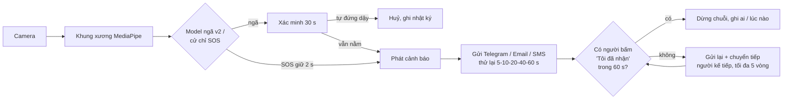

<p align="center">
  
</p>

<h1 align="center">SafeWatch: Giám sát an toàn cá nhân bằng AI</h1>

SafeWatch dùng một webcam thông thường để theo dõi người thân (thường là người cao tuổi sống một mình) trong phòng. Hệ thống phát hiện **ngã không đứng dậy được** và **cử chỉ tay cầu cứu (SOS)**. Khi có sự cố, SafeWatch gửi cảnh báo qua Telegram, Email và SMS tới người liên hệ khẩn cấp, rồi **tiếp tục nhắc lại và chuyển tiếp cho người kế tiếp cho tới khi có người bấm "Tôi đã nhận"**.

---

## Mục lục
1. [Tính năng](#1-tính-năng)
2. [Đáp ứng 3 yêu cầu cải tiến của Ban tổ chức](#2-đáp-ứng-3-yêu-cầu-cải-tiến-của-ban-tổ-chức)
3. [Số liệu kiểm định](#3-số-liệu-kiểm-định)
4. [Cài đặt và chạy](#4-cài-đặt-và-chạy)
5. [Cấu hình kênh gửi cảnh báo](#5-cấu-hình-kênh-gửi-cảnh-báo)
6. [Hướng dẫn sử dụng nhanh](#6-hướng-dẫn-sử-dụng-nhanh)
7. [Kiểm thử](#7-kiểm-thử)
8. [Cấu trúc mã nguồn](#8-cấu-trúc-mã-nguồn)
9. [Giới hạn hiện tại và hướng phát triển](#9-giới-hạn-hiện-tại-và-hướng-phát-triển)
10. [Dữ liệu, giấy phép và bảo mật](#10-dữ-liệu-giấy-phép-và-bảo-mật)

---

## 1. Tính năng

| Nhóm | Chức năng |
|---|---|
| **Phát hiện ngã** | Model ngã v2 (Conv1D + GRU trên chuỗi khung xương 1,5 s, 10 khung hình/giây). Sau khi phát hiện ngã, hệ thống **theo dõi xác minh 30 s** (chỉnh được 5–300 s). Người tự đứng dậy thì huỷ, không báo động. |
| **Ngã sau vật cản** | Hông tụt nhanh rồi mất dấu giữa khung hình (khuất sau giường, sofa) thì vẫn bị coi là nghi ngã và đếm giờ xác minh. |
| **Cử chỉ SOS** | Nhận diện 14 cử chỉ tay, trong đó 3 cử chỉ cầu cứu (Need Help, Need Ambulance, Signal For Help). Có bộ lọc chống báo nhầm: tay phải giơ cao hơn vai và giữ 2 giây. |
| **Trạng thái an toàn khi mất hình** | Mất camera, không thấy người, đứng quá gần, chỉ thấy một phần cơ thể: hệ thống **không bao giờ hiển thị "An toàn"** mà hiện trạng thái riêng, kèm **nhắc bằng giọng nói** ("Xin mời quý vị rời xa camera một chút"). |
| **Chuỗi cảnh báo** | Gửi đồng thời Telegram / Email / SMS. Gửi lỗi thì thử lại sau 5, 10, 20, 40, 60 s. Sau 60 s chưa ai xác nhận thì gửi lại và **chuyển tiếp cho người liên hệ kế tiếp**, tối đa 5 vòng. Ghi lại ai xác nhận, qua kênh nào, lúc nào. |
| **Xác nhận "Tôi đã nhận"** | Nút ngay trong Telegram, nút trong email, link trong SMS, hoặc nút trên web. Xác nhận xong thì chuỗi cảnh báo dừng. |
| **Báo cáo** | Trang Tổng quan (sự cố theo ngày / giờ, thời gian người nhà phản hồi), Nhật ký, bảng thời gian *phát hiện → gửi → xác nhận* xuất được CSV, trang Kiểm định hiển thị số liệu. |
| **Thử nghiệm** | Theo dõi nhiều người cùng lúc (tối đa 3), nhận cử chỉ khi đứng xa camera. Cả hai **tắt mặc định**, số đo có trong tài liệu kiểm định. |

### Luồng cảnh báo



---

## 2. Đáp ứng 3 yêu cầu cải tiến của Ban tổ chức

| Yêu cầu | Đã làm | Kiểm chứng ở đâu |
|---|---|---|
| **YC1: Chuỗi cảnh báo tới người nhà** | Gửi qua nhiều kênh, thử lại khi lỗi, nhắc lại và chuyển tiếp khi chưa ai xác nhận, xác nhận bằng một chạm. Đo thời gian từng bước. | `notifier.py`, `tests/test_notifier.py`. Trang **Cảnh báo → Kiểm thử chuỗi cảnh báo & bảng thời gian** (xuất CSV). |
| **YC2: Kiểm định sự kiện ngã** | Tách dữ liệu theo người và phiên quay, không dùng tập test để chọn mô hình, đóng băng hệ thống (tag `dong-bang-v1`) rồi chấm một lần trên dữ liệu chưa từng dùng (Le2i, OmniFall-Syn, Charades). | [`training/fall_eval/KIEM_DINH_THEO_YEU_CAU_BTC.md`](training/fall_eval/KIEM_DINH_THEO_YEU_CAU_BTC.md), [`models/MODEL_VERSIONS.md`](models/MODEL_VERSIONS.md), trang **Kiểm định** trong app |
| **YC3: Trạng thái an toàn khi mất hình** | Mất camera / không thấy người / bị che không bao giờ hiển thị là an toàn. Mất dấu sau khi ngã thì vẫn tiếp tục đếm giờ. | `framing.py`, `tests/test_observation_safety.py`, `tests/test_framing.py` |

---

## 3. Số liệu kiểm định

Mọi số đều chấm trên dữ liệu **model không thấy lúc train**, phát lại qua **đúng code của app** (`training/fall_eval/replay_eval.py`).

| Bài kiểm định | Kết quả |
|---|---|
| **Le2i**: dữ liệu thật, 9 người, 6 phòng, chưa từng dùng cho bất kỳ quyết định nào | Bắt được **121/129 ca ngã (94%)** |
| Le2i **có vật cản** che dải dưới khung hình 20% / 30% / 40% | 115 / **105** / 74 trên 129 ca ngã |
| **Charades**: 5 giờ sinh hoạt thật trong khoảng 500 ngôi nhà | **9 cảnh báo nhầm / giờ** (model cũ: 61 / giờ) |
| **Cử chỉ SOS** có bộ lọc, trên 3,2 giờ sinh hoạt | **1,9 lần báo nhầm / giờ** (khi chưa lọc: 132 / giờ) |
| **Chuỗi cảnh báo**: 52 cảnh báo thật | Trung vị từ lúc phát cảnh báo tới lúc gửi được: **1,1 s** |

Chi tiết và cách tính:
- [`KIEM_DINH_THEO_YEU_CAU_BTC.md`](training/fall_eval/KIEM_DINH_THEO_YEU_CAU_BTC.md)
- [`results_che_goc_tong_hop.md`](training/fall_eval/results_che_goc_tong_hop.md) (vật cản)
- [`KIEM_DINH_TAY_XA.md`](training/hand_eval/KIEM_DINH_TAY_XA.md) (cử chỉ tay)
- [`KIEM_DINH_NHIEU_NGUOI.md`](training/fall_eval/KIEM_DINH_NHIEU_NGUOI.md) (nhiều người)

---

## 4. Cài đặt và chạy

### Yêu cầu
- **Python 3.12.** MediaPipe 0.10.21 và TensorFlow 2.19 chưa hỗ trợ Python 3.13.
- Webcam và trình duyệt Chrome / Edge / Firefox bản mới.
- Khoảng 3 GB dung lượng trống cho thư viện (TensorFlow, MediaPipe).

### Các bước

```bash
# 1. Tải mã nguồn
git clone https://github.com/shinjiduck/combined-demo.git safewatch
cd safewatch

# 2. Tạo môi trường Python 3.12
#    Windows:
py -3.12 -m venv .venv
.venv\Scripts\activate
#    macOS / Linux:
python3.12 -m venv .venv
source .venv/bin/activate

# 3. Cài thư viện
pip install -r requirements.txt

# 4. Tạo file cấu hình (không bắt buộc điền gì để chạy thử)
#    Windows:
copy .streamlit\secrets.toml.example .streamlit\secrets.toml
#    macOS / Linux:
cp .streamlit/secrets.toml.example .streamlit/secrets.toml

# 5. Chạy
streamlit run main.py
```

Trình duyệt tự mở **http://localhost:8501**. Vào **Trực tiếp**, bấm **Bắt đầu giám sát** và cho phép dùng camera.

> Lần mở đầu tiên mất khoảng 10–30 giây để nạp model AI. Nếu hiện hộp thoại "Page not found" thì tải lại trang.

### Chạy bằng Docker (tuỳ chọn)

```bash
docker build -t safewatch .
docker run -p 8501:8501 -v "$(pwd)/.streamlit/secrets.toml:/app/.streamlit/secrets.toml:ro" safewatch
```

---

## 5. Cấu hình kênh gửi cảnh báo

Khai báo trong `.streamlit/secrets.toml`. Mẫu đầy đủ, có chú thích: [`.streamlit/secrets.toml.example`](.streamlit/secrets.toml.example). Kênh nào để trống thì tự tắt. Không điền kênh nào thì app vẫn chạy, chỉ không gửi ra ngoài.

| Kênh | Khoá cần có | Ghi chú |
|---|---|---|
| **Telegram** (khuyến nghị) | `TELEGRAM_BOT_TOKEN` | Miễn phí. Có nút "Đã nhận" ngay trong tin nhắn. Người nhận nhắn `/start` cho bot để lấy Chat ID. |
| **Email** | `SMTP_HOST`, `SMTP_PORT`, `SMTP_USER`, `SMTP_PASSWORD` | Email HTML có nút "Tôi đã nhận". Gmail cần *App Password*. |
| **SMS Brandname (eSMS)** | `ESMS_API_KEY`, `ESMS_SECRET_KEY`, `ESMS_BRANDNAME`, `ESMS_TEMPLATE` | Brandname và mẫu tin phải được nhà mạng duyệt. `ESMS_SANDBOX = "1"` để thử không tốn tiền. |
| **SMS qua điện thoại Android** | `SMS_GATEWAY_URL`, `SMS_GATEWAY_USER`, `SMS_GATEWAY_PASSWORD` | Dùng SIM của máy Android cài app *SMS Gateway for Android*. Không cần brandname. |
| **SMS qua Twilio** | `TWILIO_ACCOUNT_SID`, `TWILIO_AUTH_TOKEN`, `TWILIO_FROM` | Gửi về số Việt Nam cần đăng ký tên người gửi. |
| Link xác nhận | `PUBLIC_BASE_URL` | Địa chỉ web của app, dùng cho link "Tôi đã nhận" trong email và SMS. |

Sau khi điền thì khởi động lại app. Vào **Người liên hệ** thêm ít nhất một người, rồi vào **Cảnh báo → Giả lập sự kiện ngã** để thử. Nút này **gửi thật** tới người liên hệ, có ghi nhãn *[THỬ NGHIỆM]*.

---

## 6. Hướng dẫn sử dụng nhanh

| Trang | Dùng để |
|---|---|
| **Giám sát → Trực tiếp** | Bật camera, xem trạng thái (An toàn / Đang theo dõi sau ngã / Khẩn cấp / Không có người), thời gian giám sát |
| **Giám sát → Cảnh báo** | Cảnh báo chờ xác nhận, chi tiết gửi từng kênh, gửi SMS thử, giả lập sự kiện, bảng thời gian xuất CSV |
| **Giám sát → Nhật ký** | Lịch sử sự cố và thay đổi trạng thái hệ thống |
| **Thiết lập → Người liên hệ** | Thêm người nhận cảnh báo, thứ tự ưu tiên, Telegram Chat ID |
| **Thiết lập → Camera & lắp đặt** | Độ phân giải, lật hình, hướng dẫn đặt camera (cao khoảng 2 m, chéo góc phòng, cách khoảng 3 m) |
| **Thiết lập → Cấu hình** | Bật/tắt phát hiện ngã, cử chỉ, thời gian xác minh, giọng nói, các tính năng thử nghiệm |
| **Báo cáo → Tổng quan / Kiểm định** | Thống kê sự cố, số liệu kiểm định mô hình |

---

## 7. Kiểm thử

```bash
# Windows (PowerShell)
Get-ChildItem tests\test_*.py | ForEach-Object { python -X utf8 $_.FullName }
# macOS / Linux
for f in tests/test_*.py; do python "$f"; done
```

Có 56 ca kiểm thử: chuỗi cảnh báo, trạng thái an toàn khi mất hình, khung hình, bộ theo dõi ngã, nhiều người, nhận tay ở xa. Mỗi file in ra `x/x ca đạt`.

Muốn chạy lại kiểm định mô hình thì cần tải bộ dữ liệu về theo hướng dẫn trong `training/fall_eval/` (dữ liệu không nằm trong repo, xem mục 10).

---

## 8. Cấu trúc mã nguồn

```
main.py                 Điểm vào: menu, logo, bộ gửi cảnh báo chạy nền, trang xác nhận /?ack=
views/                  Các trang: live_view, alerts, history, emergency_contacts,
                        camera_management, settings, dashboard, evaluation, account
webrtc_processor.py     Xử lý từng khung hình (khung xương, ngã, cử chỉ, trạng thái)
detection_engine.py     Nạp model, cấu hình mặc định, bộ theo dõi ngã v2
fall_v2.py              Model ngã v2 (đặc trưng chuỗi khung xương)
framing.py              Quá gần / khuất / rời khung hình, giọng nói, luật ngã sau vật cản
hand_roi.py             Lọc SOS (tay cao hơn vai + giữ 2 s), nhận tay ở xa
multi_person.py         Theo dõi nhiều người (thử nghiệm)
notifier.py             Chuỗi cảnh báo: kênh gửi, thử lại, chuyển tiếp, xác nhận, email HTML
contacts.py, event_log.py, profile_store.py   Lưu người liên hệ, nhật ký, hồ sơ (SQLite / JSON trong data/)
theme.py                Hệ thống giao diện (màu, chữ, thành phần); quy ước ở DESIGN.md
models/                 Model đã train + MODEL_VERSIONS.md (lịch sử, cách quay lại bản cũ)
training/               Script train, thu dữ liệu, kiểm định (fall_eval/, hand_eval/)
tests/                  Kiểm thử tự động
assets/                 Logo, file giọng nói
static/fonts/           Font Be Vietnam Pro (giấy phép OFL)
PRODUCT.md, DESIGN.md   Mô tả sản phẩm và hệ thống thiết kế giao diện
```

---

## 9. Giới hạn hiện tại và hướng phát triển

**Giới hạn của phiên bản hiện tại**
- **Camera chạy qua trình duyệt:** phải giữ tab Trực tiếp mở. Mỗi lúc chỉ hỗ trợ 1 camera.
- **Chưa có đăng nhập:** ai truy cập được địa chỉ web là xem được dữ liệu. Chưa nên mở công khai ra Internet.
- **Mất internet:** cảnh báo nằm chờ trong hàng đợi, có mạng lại mới gửi.
- **Dữ liệu** (người liên hệ, nhật ký) lưu trên máy chạy app (`data/`). Khi chạy trên Streamlit Cloud, dữ liệu này mất mỗi lần khởi động lại.
- **Chưa hỗ trợ:** lưu ảnh / video sự cố, nhiều tài khoản.

**Hướng phát triển**
- **Thiết bị SafeWatch Box** đặt tại nhà, chạy 24/7 không cần trình duyệt: máy tính nhỏ (Raspberry Pi 5 / mini PC), camera USB hoặc IP, **module 4G gắn SIM** để nhắn SMS và gọi điện khi mất internet, loa báo động tại chỗ, pin dự phòng.
- **Máy chủ** nhận sự kiện và "nhịp tim" từ Box. Box im lặng quá vài phút thì báo người nhà *"mất kết nối thiết bị, chưa xác nhận được an toàn"*.
- Đăng nhập và phân quyền, cơ sở dữ liệu ngoài, Zalo ZNS, gọi điện tự động.

---

## 10. Dữ liệu, giấy phép và bảo mật

- **Không có video hay dữ liệu huấn luyện nào trong repo.** Các bộ dữ liệu (URFD, CAUCAFall, GMDCSA-24, Le2i, OmniFall, Charades…) phải tải từ nguồn gốc, theo giấy phép của từng bộ.
- **Charades** chỉ được dùng để *đánh giá*, theo giấy phép của bộ dữ liệu. Repo chỉ công bố con số tổng hợp, không phân phối lại dữ liệu hay dữ liệu dẫn xuất.
- **Hình ảnh camera** chỉ dùng để nhận diện, không được lưu lại hay đính kèm trong cảnh báo.
- **Khoá bí mật** (`.streamlit/secrets.toml`) nằm trong `.gitignore` và không bao giờ được commit. Chỉ file mẫu `secrets.toml.example` (không chứa giá trị) có trong repo.
- Font Be Vietnam Pro: SIL Open Font License (`static/fonts/OFL.txt`).
