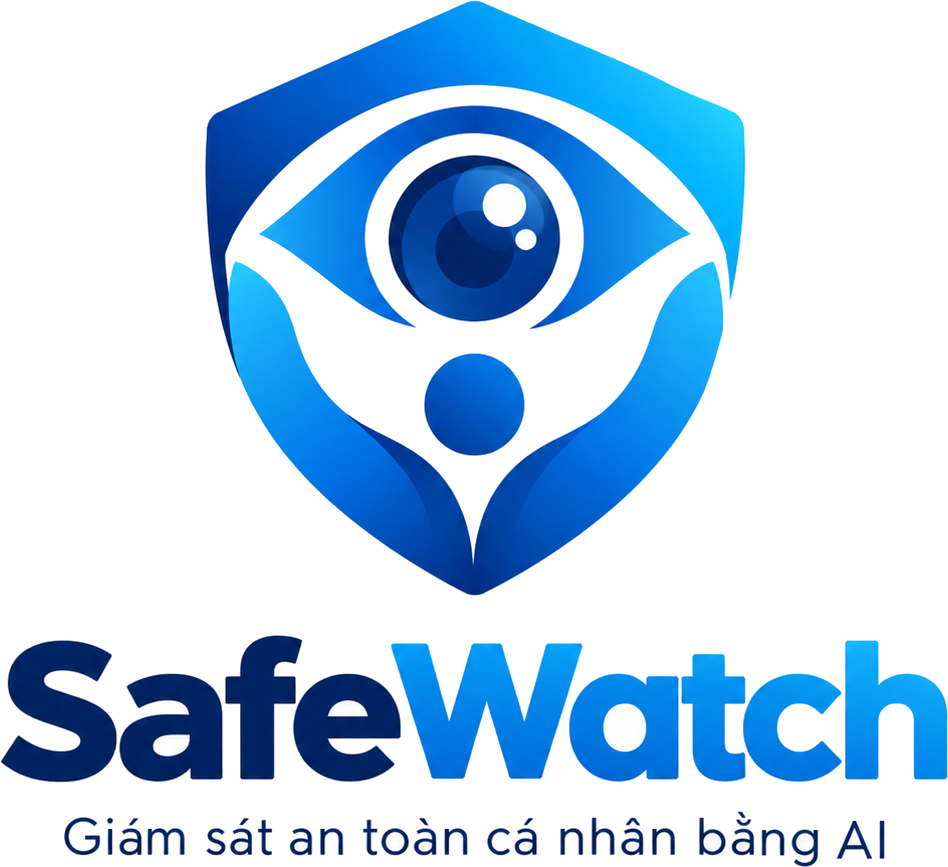
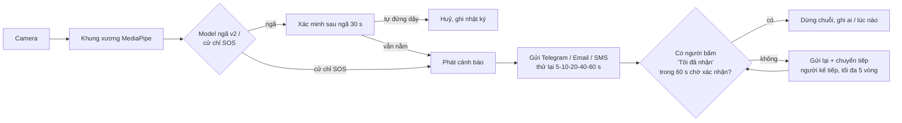

<p align="center">
  
</p>

<h1 align="center">SafeWatch: Giám sát an toàn cá nhân bằng AI</h1>

SafeWatch dùng một webcam thông thường để theo dõi người thân (thường là người cao tuổi sống một mình) trong phòng. Hệ thống phát hiện **ngã không đứng dậy được** và **cử chỉ tay cầu cứu (SOS)**. Khi có sự cố, SafeWatch gửi cảnh báo qua Telegram, Email và SMS tới người liên hệ khẩn cấp, rồi **tiếp tục nhắc lại và chuyển tiếp cho người kế tiếp cho tới khi có người bấm "Tôi đã nhận"**.

---

## Mục lục
1. [Tính năng](#1-tính-năng)
2. [Đáp ứng 3 yêu cầu cải tiến của Ban tổ chức](#2-đáp-ứng-3-yêu-cầu-cải-tiến-của-ban-tổ-chức)
3. [Số liệu kiểm định](#3-số-liệu-kiểm-định)
4. [Cài đặt và chạy](#4-cài-đặt-và-chạy)
5. [Cấu hình kênh gửi cảnh báo](#5-cấu-hình-kênh-gửi-cảnh-báo)
6. [Hướng dẫn sử dụng nhanh](#6-hướng-dẫn-sử-dụng-nhanh)
7. [Kiểm thử](#7-kiểm-thử)
8. [Cấu trúc mã nguồn](#8-cấu-trúc-mã-nguồn)
9. [Giới hạn hiện tại và hướng phát triển](#9-giới-hạn-hiện-tại-và-hướng-phát-triển)
10. [Dữ liệu, giấy phép và bảo mật](#10-dữ-liệu-giấy-phép-và-bảo-mật)

---

## 1. Tính năng

| Nhóm | Chức năng |
|---|---|
| **Phát hiện ngã** | Model ngã v2 (Conv1D + GRU trên chuỗi khung xương 1,5 s, 10 khung hình/giây). Sau khi phát hiện ngã, hệ thống chạy **thời gian xác minh sau ngã 30 s** (chỉnh được 5–300 s). Người tự đứng dậy thì huỷ, không báo động. |
| **Ngã sau vật cản** | Hông tụt nhanh rồi mất dấu giữa khung hình (khuất sau giường, sofa) thì vẫn bị coi là nghi ngã và đếm giờ xác minh. |
| **Cử chỉ SOS** | Nhận diện 14 cử chỉ tay, trong đó 3 cử chỉ cầu cứu (Need Help, Need Ambulance, Signal For Help). **Bộ lọc chống báo nhầm bật sẵn**: cử chỉ phải giữ liên tục 2 giây. Tuỳ chọn chặt hơn: chỉ nhận khi giơ tay cao hơn vai. |
| **Trạng thái an toàn khi mất hình** | Mất camera, không thấy người, đứng quá gần, chỉ thấy một phần cơ thể: hệ thống **không bao giờ hiển thị "An toàn"** mà hiện trạng thái riêng, kèm **nhắc bằng giọng nói** ("Xin mời quý vị rời xa camera một chút"). |
| **Chuỗi cảnh báo** | Gửi đồng thời Telegram / Email / SMS. Gửi lỗi thì thử lại sau 5, 10, 20, 40, 60 s. Hết **thời gian chờ xác nhận 60 s** mà chưa ai bấm thì gửi lại và **chuyển tiếp cho người liên hệ kế tiếp**, tối đa 5 vòng. Ghi lại ai xác nhận, qua kênh nào, lúc nào. |
| **Xác nhận "Tôi đã nhận"** | Nút ngay trong Telegram, nút trong email, link trong SMS, hoặc nút trên web. Xác nhận xong thì chuỗi cảnh báo dừng. |
| **Phân quyền & quyền riêng tư** | Đăng nhập (mật khẩu băm scrypt, khoá khi sai 5 lần), 3 vai trò: quản trị gia đình, người chăm sóc, người được giám sát (PIN 6 số). Quản trị gia đình **tạo tài khoản** cho từng người; người đó đăng nhập là dùng được. **Không lưu video.** Người được giám sát phải đồng ý trước khi giám sát, rút lại được, **tạm dừng vì riêng tư** tối đa 60 phút. Tự xoá dữ liệu quá hạn lưu (mặc định 30 ngày); xoá 4 mức (1 sự kiện, theo ngày, toàn bộ lịch sử, toàn bộ dữ liệu cá nhân); số điện thoại, email, hồ sơ sức khoẻ được mã hoá; nhật ký truy cập. |
| **Báo cáo** | Trang Tổng quan (sự cố theo ngày / giờ, thời gian người nhà phản hồi), Nhật ký, bảng thời gian *phát hiện → gửi → xác nhận* xuất được CSV, trang Kiểm định hiển thị số liệu. |
| **Thử nghiệm** | Signal for Help theo chuỗi động tác (học từ 60 chuỗi, chưa đánh giá độc lập), theo dõi nhiều người cùng lúc (tối đa 3), nhận cử chỉ khi đứng xa camera. Cả ba **tắt mặc định** và không dùng trong bản trình diễn; số đo có trong tài liệu kiểm định. |

Thông số đầy đủ của bản đang chạy (commit, model, ngưỡng, thời gian chờ, tính năng bật/tắt) xem trong app ở trang **Báo cáo → Phiên bản**, hoặc chạy `python -X utf8 version_info.py`.

### Luồng cảnh báo



---

## 2. Đáp ứng 3 yêu cầu cải tiến của Ban tổ chức

| Yêu cầu | Đã làm | Kiểm chứng ở đâu |
|---|---|---|
| **YC1: Chuỗi cảnh báo tới người nhà** | Gửi qua nhiều kênh, thử lại khi lỗi, nhắc lại và chuyển tiếp khi chưa ai xác nhận, xác nhận bằng một chạm. Đo thời gian từng bước. | `notifier.py`, `tests/test_notifier.py`. Trang **Cảnh báo → Kiểm thử chuỗi cảnh báo & bảng thời gian** (xuất CSV). |
| **YC2: Kiểm định sự kiện ngã** | Tách dữ liệu theo người và phiên quay, không dùng tập test để chọn mô hình, đóng băng hệ thống (tag `dong-bang-v1`) rồi chấm một lần trên dữ liệu chưa từng dùng (Le2i, OmniFall-Syn, Charades). | [`training/fall_eval/KIEM_DINH_THEO_YEU_CAU_BTC.md`](training/fall_eval/KIEM_DINH_THEO_YEU_CAU_BTC.md), [`models/MODEL_VERSIONS.md`](models/MODEL_VERSIONS.md), trang **Kiểm định** trong app |
| **YC3: Trạng thái an toàn khi mất hình** | Mất camera / không thấy người / bị che không bao giờ hiển thị là an toàn. Mất dấu sau khi ngã thì vẫn tiếp tục đếm giờ. | `framing.py`, `tests/test_observation_safety.py`, `tests/test_framing.py` |
| **Bảo vệ video người dùng** | Không lưu video (xử lý trong bộ nhớ rồi bỏ). Đăng nhập + phân quyền theo vai trò, sự đồng ý của người được giám sát, tạm dừng vì riêng tư, hạn lưu tự xoá, xoá 4 mức, mã hoá trường nhạy cảm, nhật ký truy cập. | `auth.py`, `privacy.py`, `secure_store.py`, `tests/test_auth.py`, `tests/test_privacy.py`. Trang **Tài khoản → Quyền riêng tư** (sơ đồ dữ liệu, xoá, nhật ký) |

---

## 3. Số liệu kiểm định

Mọi số đều chấm trên dữ liệu **model không thấy lúc train**, phát lại qua **đúng code của app** (`training/fall_eval/replay_eval.py`).

| Bài kiểm định | Kết quả |
|---|---|
| **Le2i**: dữ liệu thật, 9 người, 6 phòng, chưa từng dùng cho bất kỳ quyết định nào | Bắt được **121/129 ca ngã (94%)** |
| Le2i, giữ nguyên tư thế cuối thêm 40 s để chấm trọn 30 s xác minh | Ngã rồi nằm yên: **gửi cảnh báo 94/122 ca**, trung vị 30,8 s sau cú ngã. 21 ca bắt được nhưng bị coi nhầm là đã đứng dậy (người nằm dọc hướng nhìn của camera); đã rõ nguyên nhân, **chưa sửa** |
| Le2i **có vật cản** che dải dưới khung hình 20% / 30% / 40% | 115 / **105** / 74 trên 129 ca ngã |
| **Charades**: 5 giờ sinh hoạt thật trong khoảng 500 ngôi nhà | **8 cảnh báo ngã nhầm / giờ** (model cũ: 61 / giờ) |
| **Cử chỉ SOS** báo nhầm, trên video sinh hoạt Charades (không ai ra hiệu) | **5,6 lần / giờ với bộ lọc giữ 2 giây (mặc định)**; 1,9 lần / giờ khi thêm điều kiện giơ tay cao hơn vai; 132 lần / giờ khi tắt lọc |
| **Cử chỉ tay** 14 nhãn | 99,54% trên tập kiểm tra nội bộ, **chia ngẫu nhiên theo khung hình** (44.400 khung): các khung liền nhau của cùng một người nằm ở cả tập học và tập kiểm tra nên con số này cao hơn thực tế. **Độ nhạy cử chỉ ngoài thực tế chưa đo** |
| **Chuỗi cảnh báo**: 52 cảnh báo thật | Trung vị từ lúc phát cảnh báo tới lúc gửi được: **1,1 s** |

Đây là kiểm định trên **dữ liệu độc lập** (người, phòng, góc camera model chưa thấy), chưa phải thử với **người ngoài nhóm**. Con số nào cũng chỉ đúng với dữ liệu ghi bên cạnh, chưa khẳng định cho môi trường thực tế.

Chi tiết và cách tính:
- [`KIEM_DINH_THEO_YEU_CAU_BTC.md`](training/fall_eval/KIEM_DINH_THEO_YEU_CAU_BTC.md)
- [`results_che_goc_tong_hop.md`](training/fall_eval/results_che_goc_tong_hop.md) (vật cản)
- [`KIEM_DINH_TAY_XA.md`](training/hand_eval/KIEM_DINH_TAY_XA.md) (cử chỉ tay)
- [`KIEM_DINH_NHIEU_NGUOI.md`](training/fall_eval/KIEM_DINH_NHIEU_NGUOI.md) (nhiều người)

---

## 4. Cài đặt và chạy

### Yêu cầu
- **Python 3.12.** MediaPipe 0.10.21 và TensorFlow 2.19 chưa hỗ trợ Python 3.13.
- Webcam và trình duyệt Chrome / Edge / Firefox bản mới.
- Khoảng 3 GB dung lượng trống cho thư viện (TensorFlow, MediaPipe).

### Các bước

```bash
# 1. Tải mã nguồn
git clone https://github.com/shinjiduck/SafeWatch.git safewatch
cd safewatch

# 2. Tạo môi trường Python 3.12
#    Windows:
py -3.12 -m venv .venv
.venv\Scripts\activate
#    macOS / Linux:
python3.12 -m venv .venv
source .venv/bin/activate

# 3. Cài thư viện
pip install -r requirements.txt

# 4. Tạo file cấu hình (không bắt buộc điền gì để chạy thử)
#    Windows:
copy .streamlit\secrets.toml.example .streamlit\secrets.toml
#    macOS / Linux:
cp .streamlit/secrets.toml.example .streamlit/secrets.toml

# 5. Chạy
streamlit run main.py
```

Trình duyệt tự mở **http://localhost:8501**. Lần đầu: người mở app đầu tiên tạo tài khoản quản trị gia đình, rồi vào
**Tài khoản & quyền** tạo tài khoản cho người chăm sóc và người được giám sát (PIN 6 số). Người được giám sát đăng nhập,
đọc và bấm **đồng ý** ở trang **Trực tiếp**, sau đó bấm **Bắt đầu giám sát** và cho phép dùng camera.

> Lần mở đầu tiên mất khoảng 10–30 giây để nạp model AI. Nếu hiện hộp thoại "Page not found" thì tải lại trang.

### Chạy bằng Docker (tuỳ chọn)

```bash
docker build -t safewatch .
docker run -p 8501:8501 -v "$(pwd)/.streamlit/secrets.toml:/app/.streamlit/secrets.toml:ro" safewatch
```

---

## 5. Cấu hình kênh gửi cảnh báo

Khai báo trong `.streamlit/secrets.toml`. Mẫu đầy đủ, có chú thích: [`.streamlit/secrets.toml.example`](.streamlit/secrets.toml.example). Kênh nào để trống thì tự tắt. Không điền kênh nào thì app vẫn chạy, chỉ không gửi ra ngoài.

| Kênh | Khoá cần có | Ghi chú |
|---|---|---|
| **Telegram** (khuyến nghị) | `TELEGRAM_BOT_TOKEN` | Miễn phí. Có nút "Đã nhận" ngay trong tin nhắn. Người nhận nhắn `/start` cho bot để lấy Chat ID. |
| **Email** | `SMTP_HOST`, `SMTP_PORT`, `SMTP_USER`, `SMTP_PASSWORD` | Email HTML có nút "Tôi đã nhận". Gmail cần *App Password*. |
| **SMS Brandname (eSMS)** | `ESMS_API_KEY`, `ESMS_SECRET_KEY`, `ESMS_BRANDNAME`, `ESMS_TEMPLATE` | Brandname và mẫu tin phải được nhà mạng duyệt. `ESMS_SANDBOX = "1"` để thử không tốn tiền. |
| **SMS qua điện thoại Android** | `SMS_GATEWAY_URL`, `SMS_GATEWAY_USER`, `SMS_GATEWAY_PASSWORD` | Dùng SIM của máy Android cài app *SMS Gateway for Android*. Không cần brandname. |
| **SMS qua Twilio** | `TWILIO_ACCOUNT_SID`, `TWILIO_AUTH_TOKEN`, `TWILIO_FROM` | Gửi về số Việt Nam cần đăng ký tên người gửi. |
| Link xác nhận | `PUBLIC_BASE_URL` | Địa chỉ web của app, dùng cho link "Tôi đã nhận" trong email và SMS. |

Sau khi điền thì khởi động lại app. Vào **Người liên hệ** thêm ít nhất một người, rồi vào **Cảnh báo → Giả lập sự kiện ngã** để thử. Nút này **gửi thật** tới người liên hệ, có ghi nhãn *[THỬ NGHIỆM]*.

---

## 6. Hướng dẫn sử dụng nhanh

| Trang | Dùng để |
|---|---|
| **Giám sát → Trực tiếp** | Bật camera, xem trạng thái (An toàn / Đang theo dõi sau ngã / Khẩn cấp / Không có người), thời gian giám sát |
| **Giám sát → Thử bằng video** | Tải lên video quay sẵn (tối đa 3 phút). SafeWatch phân tích bằng đúng bộ nhận diện của camera trực tiếp, cho xem video có khung xương + trạng thái, diễn biến theo thời gian, lúc phát hiện ngã, lúc gửi cảnh báo. Chọn được thời gian xác minh rút ngắn cho video ngắn; tuỳ chọn gửi cảnh báo thử (ghi rõ GIẢ LẬP). Dùng khi không demo trực tiếp được |
| **Giám sát → Cảnh báo** | Cảnh báo chờ xác nhận, chi tiết gửi từng kênh, gửi SMS thử, giả lập sự kiện, bảng thời gian xuất CSV |
| **Giám sát → Nhật ký** | Lịch sử sự cố và thay đổi trạng thái hệ thống |
| **Thiết lập → Người liên hệ** | Thêm người nhận cảnh báo, thứ tự ưu tiên, Telegram Chat ID |
| **Thiết lập → Camera & lắp đặt** | Độ phân giải, lật hình, hướng dẫn đặt camera (cao khoảng 2 m, chéo góc phòng, cách khoảng 3 m) |
| **Thiết lập → Cấu hình** | Bật/tắt phát hiện ngã, cử chỉ, thời gian xác minh, giọng nói, các tính năng thử nghiệm |
| **Báo cáo → Tổng quan / Kiểm định / Phiên bản** | Thống kê sự cố, số liệu kiểm định mô hình, thông số bản đang chạy |
| **Tài khoản → Tài khoản & quyền** | Đổi mật khẩu; quản trị tạo / khoá tài khoản, đổi vai trò, đặt lại mật khẩu; bảng quyền của từng vai trò |
| **Tài khoản → Quyền riêng tư** | Sơ đồ dữ liệu, sự đồng ý, hạn lưu, xoá dữ liệu, nhật ký truy cập |

---

## 7. Kiểm thử

```bash
# Windows (PowerShell)
Get-ChildItem tests\test_*.py | ForEach-Object { python -X utf8 $_.FullName }
# macOS / Linux
for f in tests/test_*.py; do python "$f"; done
```

Các ca kiểm thử gồm: chuỗi cảnh báo, trạng thái an toàn khi mất hình, khung hình, bộ theo dõi ngã, nhiều người, nhận tay ở xa, và **đồng bộ tài liệu** (`test_dong_bo_tai_lieu.py`: README / landing ghi thông số khác code thì test đỏ). Mỗi file in ra `x/x ca đạt`.

Muốn chạy lại kiểm định mô hình thì cần tải bộ dữ liệu về theo hướng dẫn trong `training/fall_eval/` (dữ liệu không nằm trong repo, xem mục 10).

---

## 8. Cấu trúc mã nguồn

```
main.py                 Điểm vào: menu, logo, bộ gửi cảnh báo chạy nền, trang xác nhận /?ack=
views/                  Các trang: live_view, video_demo, alerts, history, emergency_contacts,
                        camera_management, settings, dashboard, evaluation, version, account,
                        users, privacy_center
webrtc_processor.py     Xử lý từng khung hình (khung xương, ngã, cử chỉ, trạng thái)
video_demo.py           Phân tích video tải lên bằng đúng bộ xử lý trên (đồng hồ theo video, không ghi nhật ký thật)
detection_engine.py     Nạp model, cấu hình mặc định, bộ theo dõi ngã v2
fall_v2.py              Model ngã v2 (đặc trưng chuỗi khung xương)
framing.py              Quá gần / khuất / rời khung hình, giọng nói, luật ngã sau vật cản
hand_roi.py             Lọc SOS (tay cao hơn vai + giữ 2 s), nhận tay ở xa
hand_features.py        Chuẩn hoá landmark bàn tay, dùng chung cho huấn luyện và app
multi_person.py         Theo dõi nhiều người (thử nghiệm)
notifier.py             Chuỗi cảnh báo: kênh gửi, thử lại, chuyển tiếp, xác nhận, email HTML
version_info.py         Một nguồn cho thông số bản đang chạy: trang Phiên bản, bảng cấu hình, test đồng bộ tài liệu
auth.py                 Đăng nhập, vai trò, ma trận quyền, nhật ký truy cập
privacy.py              Sự đồng ý, tạm dừng vì riêng tư, hạn lưu, xoá dữ liệu 4 mức
secure_store.py         Mã hoá trường nhạy cảm (SĐT, email, Chat ID, hồ sơ sức khoẻ)
contacts.py, event_log.py, profile_store.py   Lưu người liên hệ, nhật ký, hồ sơ (SQLite / JSON trong data/)
theme.py                Hệ thống giao diện (màu, chữ, thành phần); quy ước ở DESIGN.md
models/                 Model đã train + MODEL_VERSIONS.md (lịch sử, cách quay lại bản cũ)
training/               Script train, thu dữ liệu, kiểm định (fall_eval/, hand_eval/)
tests/                  Kiểm thử tự động
assets/                 Logo, file giọng nói
static/fonts/           Font Be Vietnam Pro (giấy phép OFL)
PRODUCT.md, DESIGN.md   Mô tả sản phẩm và hệ thống thiết kế giao diện
```

---

## 9. Giới hạn hiện tại và hướng phát triển

**Giới hạn của phiên bản hiện tại**
- **Camera chạy qua trình duyệt:** phải giữ tab Trực tiếp mở. Mỗi lúc chỉ hỗ trợ 1 camera.
- **Đăng nhập tự xây:** mật khẩu băm scrypt, khoá khi sai nhiều lần, nhưng chưa có xác thực 2 bước hay khôi phục mật khẩu qua email. Quên mật khẩu thì quản trị đặt lại.
- **Tạm dừng vì riêng tư:** trong lúc tạm dừng (tối đa 60 phút), nếu ngã sẽ không có cảnh báo.
- **Mất internet:** cảnh báo nằm chờ trong hàng đợi, có mạng lại mới gửi.
- **Dữ liệu** (tài khoản, người liên hệ, nhật ký) lưu trên máy chạy app (`data/`). Khi chạy trên Streamlit Cloud, dữ liệu này mất mỗi lần khởi động lại (phải tạo lại tài khoản).
- **Không lưu ảnh / video sự cố** (chủ ý, để bảo vệ quyền riêng tư).
- **Số liệu:** độ nhạy cử chỉ SOS ngoài thực tế chưa đo; Signal for Help, nhiều người, nhận tay ở xa còn thử nghiệm. Bản trên Streamlit Cloud gửi khung hình lên máy chủ để xử lý và có thể chạy AI dưới 10 lần/giây khi máy chủ bận.
- SafeWatch hỗ trợ phát hiện sớm và báo người nhà, **không thay thế người chăm sóc hay dịch vụ cấp cứu**.

**Hướng phát triển**
- **Thiết bị SafeWatch Box** đặt tại nhà, chạy 24/7 không cần trình duyệt: máy tính nhỏ (Raspberry Pi 5 / mini PC), camera USB hoặc IP, **module 4G gắn SIM** để nhắn SMS và gọi điện khi mất internet, loa báo động tại chỗ, pin dự phòng.
- **Máy chủ** nhận sự kiện và "nhịp tim" từ Box. Box im lặng quá vài phút thì báo người nhà *"mất kết nối thiết bị, chưa xác nhận được an toàn"*.
- Đăng nhập bằng Google, xác thực 2 bước, cơ sở dữ liệu ngoài có mã hoá toàn bộ, Zalo ZNS, gọi điện tự động.

---

## 10. Dữ liệu, giấy phép và bảo mật

- **Không có video hay dữ liệu huấn luyện nào trong repo.** Các bộ dữ liệu (URFD, CAUCAFall, GMDCSA-24, Le2i, OmniFall, Charades…) phải tải từ nguồn gốc, theo giấy phép của từng bộ.
- **Charades** chỉ được dùng để *đánh giá*, theo giấy phép của bộ dữ liệu. Repo chỉ công bố con số tổng hợp, không phân phối lại dữ liệu hay dữ liệu dẫn xuất.
- **Hình ảnh camera** chỉ dùng để nhận diện, không được lưu lại hay đính kèm trong cảnh báo (`test_khong_luu_hinh_anh_camera`).
  Video tự tải lên ở trang Thử bằng video chỉ nằm trong file tạm lúc phân tích rồi bị xoá; kết quả chỉ giữ trong phiên
  đăng nhập (`test_video_tai_len_khong_luu_lai`).
- **Mật khẩu / PIN** băm bằng scrypt kèm salt riêng; không lưu dạng gốc.
- **Số điện thoại, email, Telegram Chat ID, hồ sơ sức khoẻ** mã hoá AES (Fernet) khi lưu. Khoá dữ liệu đặt ở `DATA_KEY` (secrets) hoặc tự tạo ở `data/.data_key` (đã trong `.gitignore`). **Mất khoá = mất các trường đã mã hoá.**
- **Xoá là xoá thật:** SQLite `secure_delete` ghi đè dữ liệu bị xoá, rồi `VACUUM`. Dữ liệu quá hạn lưu tự xoá mỗi giờ.
- **Link "Tôi đã nhận"** chỉ xác nhận đúng 1 cảnh báo, hết hạn sau 24 giờ.
- **Khoá bí mật** (`.streamlit/secrets.toml`) nằm trong `.gitignore` và không bao giờ được commit. Chỉ file mẫu `secrets.toml.example` (không chứa giá trị) có trong repo.
- Font Be Vietnam Pro: SIL Open Font License (`static/fonts/OFL.txt`).
